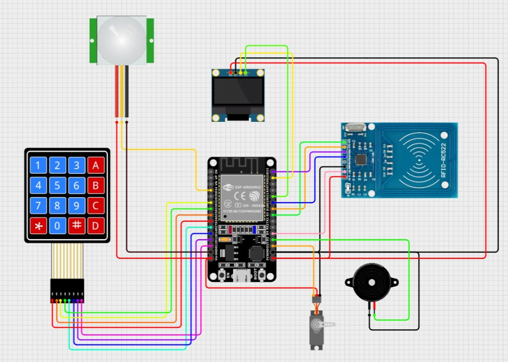
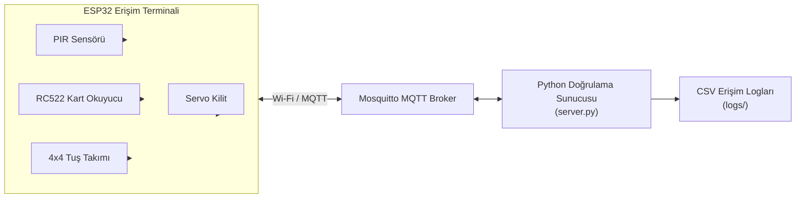

# ESP32 Tabanlı Çok Faktörlü Erişim Kontrol Sistemi

ESP32 mikrodenetleyici (RFID kart + tuş takımı + PIR hareket sensörü + servo kilit) ile Python MQTT sunucusu üzerinden çalışan gerçek zamanlı geçiş kontrol sistemi.

## Devre ve Bağlantı Şeması



| Bileşen | Sinyal | ESP32 GPIO |
|---|---|---|
| **RC522 RFID (SPI)** | SDA (SS) | 5 |
| | RST | 4 |
| | SCK / MOSI / MISO | 18 / 23 / 19 (VSPI) |
| **4x4 Tuş Takımı** | Satırlar (R1–R4) | 26, 25, 32, 33 |
| | Sütunlar (C1–C4) | 14, 27, 16, 17 |
| **PIR Hareket Sensörü** | OUT | 34 |
| **Servo Motor (Kapı Kilidi)** | PWM | 13 |

## Sistem Mimarisi ve Çalışma Akışı



1. **Hareket Algılama:** PIR sensörü hareket algıladığında `access/motion` konusuna bildirim gönderilir ve doğrulama süreci başlar.
2. **Kart Doğrulama:** Okutulan RFID kartın UID bilgisi `access/card` konusuna yayınlanır; sunucu doğrulama sonucunu `result/card` konusuna döner.
3. **Şifre Doğrulama:** Tuş takımından girilen şifre `access/password` konusuna yayınlanır; sunucu sonucu `result/password` konusuna döner.
4. **Kapı Kontrolü ve Loglama:** Doğrulama başarılıysa servo motor kapıyı 5 saniyeliğine açar. Tüm olaylar sunucu tarafında tarih damgalı CSV dosyalarına (`logs/access_log_YYYYMMDD.csv`) kaydedilir.

## Dosya Yapısı

| Dosya | Açıklama |
|---|---|
| `ESP32.ino` | ESP32 erişim terminali yazılımı (RFID, Keypad, PIR, Servo, MQTT iletişimi) |
| `server.py` | Kart ve şifre doğrulaması yapan, erişim kayıtlarını CSV'ye loglayan Python sunucusu |
| `mosquitto.txt` | Mosquitto MQTT broker servisini başlatma/durdurma ve port kontrol komutları |
| `devre_semasi.jpg` | Donanım bağlantı diyagramı |
| `requirements.txt` | Python bağımlılıkları (`paho-mqtt`) |

## Kurulum ve Çalıştırma

### 1. MQTT Broker ve Python Sunucusu
```bash
pip install -r requirements.txt
sudo systemctl start mosquitto
python server.py
```

### 2. ESP32 Kurulumu
- `ESP32.ino` dosyasındaki `WIFI_ADI`, `WIFI_SIFRESI` ve `MQTT_SUNUCU_IP` alanlarını kendi ağ bilgilerinizle güncelleyin.
- `server.py` içindeki `MQTT_BROKER` adresini ve `USERS_DB` altındaki örnek kullanıcı kart/şifre bilgilerini düzenleyin.
- Arduino IDE üzerinden gerekli kütüphaneleri (`MFRC522`, `Keypad`, `PubSubClient`, `ESP32Servo`) kurup kodu ESP32'ye yükleyin.
